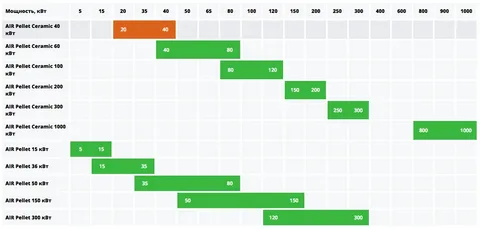

= Проект по разработке систем внедрения новых продуктов в сети закучочных "Замысловатость"

== Общая информация
Важный проект

== Цели проекта
. Цель 1
. Цель 2

== Задачи проекта
* Задача 
* ЗАдача
* Задача

== roadmap проекта

== Команда проекта
[cols="2,1", options="header"]
|===
|Должность|Количество
|Teamlead системного анализа|1
|Системный аналитик|2
|Бэк разработчик|4
|Фронт разработчик|2
|Тестировщик|2
|===

|===
|Заголовок 1 |Заголовок 2 |Заголовок 3 |Заголовок 4
3+|Эта ячейка объединяет 3 столбца |Ячейка в 4-м столбце
|===
|===
|Заголовок 1 |Заголовок 2
.2+|Эта ячейка объединяет 2 строки |Ячейка в 1-й строке, 2-й столбец
|Ячейка во 2-й строке, 2-й столбец
|===
|===
|Заголовок 1 |Заголовок 2 |Заголовок 3
2.2+|Эта ячейка объединяет 2 столбца и 2 строки |Ячейка справа
|Ячейка снизу
|===

https://github.com/ElizaZu/DocsAsCode-practicum-TL-2026-06.git[Ссылка на репозиторий]

link:../api/OpenApi_Sunset.yaml[OpenAPI yaml]

[plantuml]
....
@startuml
participant Participant as Foo
actor Actor as Foo1
boundary Boundary as Foo2
control Control as Foo3
entity  Entity as Foo4
database Database as Foo5
collections Collections as Foo6
queue Queue as Foo7
Foo -> Foo1 : To actor
Foo -> Foo2 : To boundary
Foo -> Foo3 : To control
Foo -> Foo4 : To entity
Foo -> Foo5 : To database
Foo -> Foo6 : To collections
Foo -> Foo7 : To queue
@enduml
....

[mermaid]
....
graph LR
    A[Square Rect] -- Link text --> B((Circle))
    A --> C(Round Rect)
    B --> D{Rhombus}
    C --> D
....